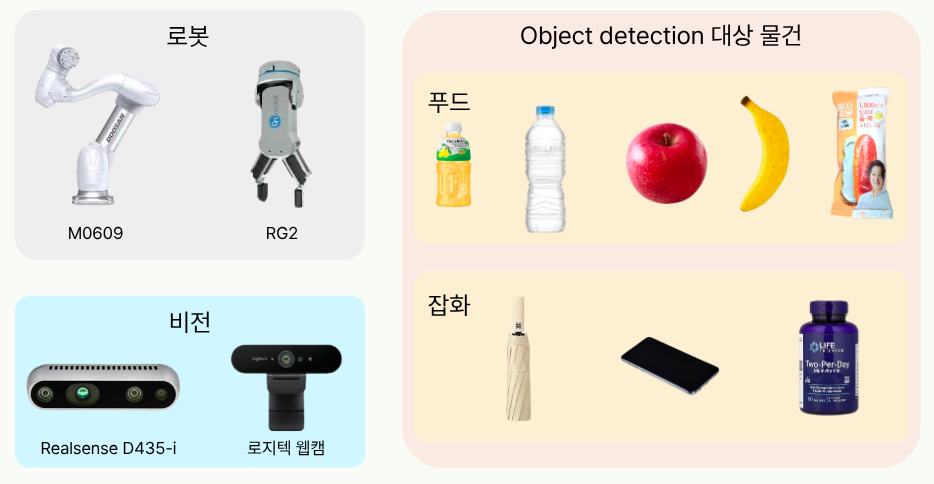
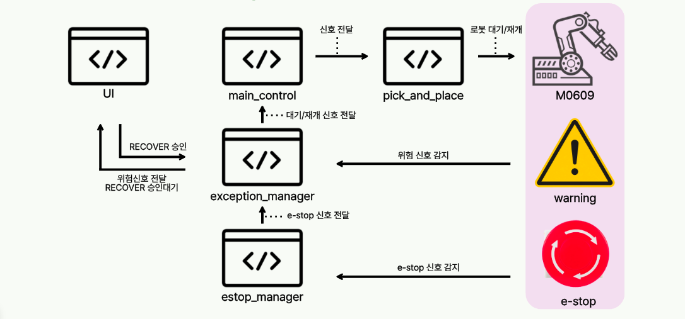
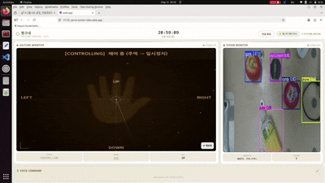
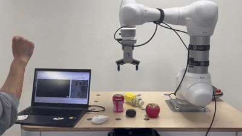
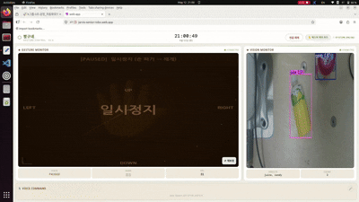
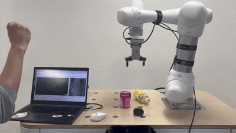

# 🤖 JARVIS — 시니어 보조 협동로봇

ROS2 + WebRTC 기반 음성·제스처·비전 통합 협동로봇 제어 시스템

---

## 📌 프로젝트 배경

대한민국은 빠르게 고령화 사회로 진입하고 있으며, 요양 인력 부족 문제가 심화되고 있습니다.
JARVIS는 이러한 문제를 해결하기 위해 시니어의 일상을 보조하는 협동로봇 시스템으로 개발되었습니다.

단순한 물건 전달을 넘어, **RAG(Retrieval-Augmented Generation)** 기반으로 개별 사용자의 건강 상태와 현재 상황을 파악하여 맞춤형 음식이나 물건을 추천합니다. 예를 들어 당뇨 환자에게는 혈당에 맞는 음식을, 외출 전에는 날씨에 맞는 준비물을 스스로 판단해 제안합니다.

**핵심 기능 요약**
- 음성 명령 / 브라우저 제스처 / 손동작으로 물건 픽앤플레이스
- RAG 기반 사용자 건강 상태 인식 → 상황에 맞는 물건 추천
- 카메라 + VLM으로 주변 환경 스캔 후 자동 픽
- 로봇 이상 상태 감지 및 자동 복구

---

## 🔗 링크

| 항목 | 링크 |
|---|---|
| 원본 레포지토리 | [https://github.com/junsu122/Rokey_Cobot2](https://github.com/junsu122/Rokey_Cobot2) |

---

## 🛠️ 활용 장비 및 재료

<p align="center">&lt;활용재료&gt;</p>

---

> 📦 **레포 구조 참고** — `web_cobot_ws/`는 웹(브라우저·WebRTC)까지 포함한 통합 버전, 최상위 `src/`는 센서·로봇만 쓰는 로컬 전용 버전으로, 같은 패키지가 두 트리에 나뉘어 있습니다.

## 🌐 구동 방법 (웹 사용 버젼)

### 1. ROS2 빌드

```bash
cd ~/rokey_cobot2_javis/web_cobot_ws
colcon build
source install/setup.bash
```

### 2. ROS2 시스템 실행

```bash
source ~/rokey_cobot2_javis/web_cobot_ws/install/setup.bash
ros2 launch jarvis_bringup jarvis_main.launch.py
```

### 3. 웹 서버 실행 (별도 터미널)

```bash
source ~/rokey_cobot2_javis/web_cobot_ws/install/setup.bash
bash ~/rokey_cobot2_javis/web_cobot_ws/jarvis_webrtc/jarvis_web.sh
```

### 4. 웹앱 빌드 & 배포 (UI 변경 시)

```bash
cd ~/rokey_cobot2_javis/web_cobot_ws/jarvis-ui/web-app
npm run build
firebase deploy --only hosting
```
---

## 💻 구동 방법 (로컬 사용 버젼)

### 1. ROS2 빌드

```bash
cd ~/rokey_cobot2_javis
colcon build
source install/setup.bash
```

### 2. 센서 연동

realsense 및 dsr01 연결

### 3. ROS2 시스템 실행 (메인 컨트롤러 런치)

```bash
ros2 launch gesture_robot_pkg gesture_robot.launch.py 
```

### 4. ROS2 시스템 실행 (상태 컨트롤러 런치)

```bash
ros2 launch robot_state_control robot_state_control.launch.py 
```

### 5. ROS2 시스템 실행 (객체 너비 확인 노드 런치)

```bash
ros2 launch object_width_filter object_width_filter.launch.py
```

docker로 대체 가능

```bash
# 1. 도커 컨테이너의 GUI 출력을 허용 (터미널에 입력)
xhost +local:docker

# 2. 통신을 위한 환경 변수 설정 (Bag 파일 실행 PC와 동일하게 맞춤)
export ROS_DOMAIN_ID=95
export RMW_IMPLEMENTATION=rmw_cyclonedds_cpp

# 3. 최신 이미지 다운로드
docker pull junsu122/object_width_filter:v2.1

# 4. 컨테이너 실행 (네트워크, 디스플레이, 카메라 권한 포함)
docker run -it --rm \
  --net=host \
  --env="DISPLAY" \
  --volume="/tmp/.X11-unix:/tmp/.X11-unix:rw" \
  --privileged \
  junsu122/object_width_filter:v2.1

# 5. 런치 파일 실행 (모든 노드 가동)
ros2 launch object_width_filter object_width_filter.launch.py
```

```bash
# 다른 PC의 ~/.bashrc에 추가
alias rf='xhost +local:docker && docker run -it --rm --net=host --env="DISPLAY" --volume="/tmp/.X11-unix:/tmp/.X11-unix:rw" --privileged junsu122/object_width_filter:v2.1'
```

---


## 🔄 전체 흐름

<p align="center">&lt;전체 아키텍처&gt;</p>


<p align="center">&lt;전체 플로우차트&gt;</p>

### 🖱️ 브라우저 호버 선택 픽

```
브라우저: 물체 위 손가락 hover
    ↓ DataChannel
webrtc_vision_server.py
    → /selected_label 발행
    → 브라우저로 is_picking=True 전송 (모달 표시)
    ↓
vision_node.py (_selected_label_cb)
    → YOLO 탐지 결과에서 원본 좌표 추출
    → /selected_object 발행
    ↓
┌─────────────────────────────────────────┐
│ 동시 처리                                │
│  orchestrator_node.py                   │
│    → PickAndPlace 액션 트리거            │
│                                         │
│  vision_node2publish_angle.py           │
│    → aligned depth + camera_info       │
│    → /_2d_to_3d_point 발행              │
│    → publish_angle.py                  │
│    → /object_angle 발행                 │
└─────────────────────────────────────────┘
    ↓
pick_and_place_node.py
    HOME → APPROACH
    → /selected_object 재발행 (각도 재계산)
    → SPIN_CHUCK (30초 대기, /object_angle 수신)
    → DESCEND → GRASP → LIFT → GIVE
    ↓
orchestrator_node.py → /is_picking=False
    ↓
브라우저: "작업 완료" 모달 표시
```

---

### 🎙️ 음성 명령 픽 (예: "사과 가져다줘")

```
브라우저 마이크 → /browser_stt
    ↓
voice_intent_node.py
    → GPT-4o 3단계 의도 추론
      (intent=bring_object, target=apple)
    → /voice_intent 발행
    ↓
vision_node.py (_voice_intent_cb)
    → YOLO에서 apple 탐지
    → /selected_object 발행
    ↓
orchestrator_node.py + vision_node2publish_angle.py (동시)
    ↓
pick_and_place_node.py
    HOME → APPROACH → SPIN_CHUCK → DESCEND → GRASP → LIFT → GIVE
```

---

### 🍎 배고프다 스캔 픽 (예: "나 배고파")

```
voice_intent_node.py
    → 현재 카메라에 음식 있으면 → 바로 픽
    → 음식 없으면 → /scan_request 발행
    ↓
workspace_scan_node.py
    → 지그재그 전체 스캔 (3×3 격자)
    → 각 위치에서 VLM으로 음식 탐지 + 저장
    → 스캔 완료 후 발견 물체 순차 처리:
        ① 물체 위로 센터링 이동
        ② /voice_intent 발행 (from_scan=True)
        ③ 픽 완료 대기
        ④ 다음 물체 반복
    → 모든 픽 완료 후 /scan_result 발행
    ↓
pick_and_place_node.py (from_scan=True)
    HOME 스킵 → APPROACH → SPIN_CHUCK → DESCEND → GRASP → LIFT → GIVE
```

---

### 🚪 외출 준비 (예: "나갈게")

```
voice_intent_node.py
    → intent=going_out
    → _plan_going_out_items():
        날씨 API + 카메라 이미지 → o4-mini
        → 우산/썬크림/물/마스크 중 필요한 것 선택
    → 각 물건 순서대로 픽 처리
    ↓
pick_and_place_node.py
    HOME → APPROACH → SPIN_CHUCK → DESCEND → GRASP → LIFT
    → WAY_POINT → GIVE_JOINT → GIVE_LINE (직접교시 위치)
```

---

## 📁 주요 파일 경로

> 레포 루트(`rokey_cobot2_javis/`) 기준 전체 경로입니다.

| 파일 | 경로 |
|---|---|
| ROS2 런처 | `web_cobot_ws/src/jarvis_bringup/launch/jarvis_main.launch.py` |
| 비전 노드 | `src/gesture_robot_pkg/gesture_robot_pkg/vision_node.py` |
| 픽앤플레이스 | `src/gesture_robot_pkg/gesture_robot_pkg/pick_and_place_node.py` |
| 오케스트레이터 | `src/gesture_robot_pkg/gesture_robot_pkg/orchestrator_node.py` |
| 각도 계산 | `src/object_width_filter/object_width_filter/vision_node2publish_angle.py` |
| 음성 의도 | `src/jarvis_voice_pkg/jarvis_voice_pkg/voice_intent_node.py` |
| 스캔 노드 | `src/jarvis_voice_pkg/jarvis_voice_pkg/workspace_scan_node.py` |
| 상태 관리 | `src/jarvis_voice_pkg/jarvis_voice_pkg/publisher.py` |
| 상수 | `src/gesture_robot_pkg/gesture_robot_pkg/constants.py` |
| WebRTC 제스처 | `web_cobot_ws/jarvis_webrtc/webrtc_server.py` |
| WebRTC 비전 | `web_cobot_ws/jarvis_webrtc/webrtc_vision_server.py` |

---

## 📡 주요 ROS2 토픽

| 토픽 | 설명 |
|---|---|
| `/selected_label` | 브라우저 호버 선택 (라벨) |
| `/selected_object` | YOLO 원본 좌표 기반 픽 트리거 |
| `/object_angle` | 물체 그리퍼 회전 각도 (degree) |
| `/voice_intent` | 음성/스캔 기반 픽 트리거 |
| `/is_picking` | 픽 진행 상태 (브라우저 모달용) |
| `/scan_request` | 스캔 시작/취소 |
| `/scan_result` | 스캔 완료 결과 |
| `/browser_stt` | 브라우저 음성 입력 |
| `/_2d_to_3d_point` | 2D bbox → 3D 카메라 좌표 |

---

## 🙋 내 주요 업무

### 1. [손동작(MediaPipe) 기반 로봇 제어]
> 웹캠 영상에서 MediaPipe로 손을 추적하여, 손동작만으로 협동로봇을 직접 제어하는 텔레오퍼레이션 기능 개발
> 1. 웹캠에서 MediaPipe Hand Landmark(21개) 추적 → Index-tip / Palm-center 추출
> 2. `WAITING → CALIBRATING → CONTROLLING ↔ PAUSED` 상태 머신으로 제어 흐름 관리
> 3. 캘리브레이션 시점의 TCP를 기준점으로, 손 이동량(delta)을 로봇 목표 좌표로 변환
> 4. 주먹(fist) / 검지 포인팅 등 제스처로 제어 시작·일시정지 전환
> 5. `move_line` 서비스를 호출해 손 움직임을 로봇 동작으로 실시간 매핑 (~30 Hz)


<p align="center">&lt;MediaPipe를 이용한 손동작 제어&gt;</p>

---

### 2. [작업공간 ㄹ자 스캔 알고리즘 제작]
> 사용자가 "배고파" 등 추천을 요청하면, 로봇이 테이블 전체를 훑으며 물체를 탐색하는 스캔 기능 개발
> 1. `/scan_request` 수신 → 스캔 시작
> 2. 작업공간을 격자(nx × ny)로 나눠 **ㄹ자(지그재그) 경로**로 순차 이동
> 3. 각 스캔 포즈에서 RealSense 컬러 이미지를 캡처하여 VLM(GPT-4o Vision)으로 물체 탐지
> 4. 타겟 물체 발견 여부를 `/scan_result` 로 발행, 진행 상태를 `/scan_status` 로 실시간 발행
> 5. 취소 요청 시 즉시 중단
>
> 테이블 전 영역을 한 시야에 담기 어려워, 지그재그 경로로 카메라를 분할 이동시키며 부분 시야를 누적해 전체를 커버하도록 설계.

---

### 3. [외력감지, 비상정지 및 복구 알고리즘 제작 (초기 설계·프로토타입)]
> 로봇의 이상 상태를 감지하고 동작을 안전하게 멈췄다가 복구하는 상태 제어 파이프라인의 초기 형태를 설계·구현
>
> **평상시** : `main_node`가 픽앤플레이스 전체 흐름을 관리하며 START/PAUSE/RESUME/STOP 명령을 발행
>
> **이상 감지 시** : `emergency_stop_node`가 로봇 상태를 주기적으로 감시하다가 외력감지(Protective Stop, 노란 경고) / 비상정지(Emergency Stop, 빨간 경고)를 감지하면 `main_node`에 이상 신호를 전달 → `main_node`가 동작을 일시정지 또는 중단
>
> **복구 시** : 웹 대시보드 버튼 또는 손바닥 제스처로 복구 신호를 보내면 `exception_manager_node`가 로봇에 복구 명령을 전송하고 `main_node`에 정상 복귀 신호를 전달 → 픽앤플레이스 동작 재개


<p align="center">&lt;외력감지 / 비상정지 복구 플로우&gt;</p>


<table>
  <tr>
    <td align="center"><b>예외처리 - 웹</b></td>
    <td align="center"><b>예외처리 - 카메라</b></td>
  </tr>
  <tr>
    <td></td>
    <td></td>
  </tr>
  <tr>
    <td align="center"><b>비상정지 - 웹</b></td>
    <td align="center"><b>비상정지 - 카메라</b></td>
  </tr>
  <tr>
    <td></td>
    <td></td>
  </tr>
</table>

---

## 🔧 Trouble Shooting

### [스캔 시 거리에 따른 YOLO 인식률 저하]
**증상**
> 사용자가 요청한 물건이 현재 화면에 없으면 작업공간을 스캔해 탐색하는데, 스캔으로 탐지한 물체의 인식이 확실하지 않음.

**원인**
> 초기에는 하나의 비전 카메라로 테이블 전체를 한 화면에 담으려고 멀리서 디텍션 → 물체가 화면에서 작아져 YOLO의 confidence가 낮아짐.

**해결 방법**
> 테이블을 한 화면에 담지 않고, 작업공간을 격자로 분할하여 **지그재그(ㄹ자) 경로로 가까이서 순차 스캔**한 뒤 결과를 JSON 파일로 순차 저장하도록 변경.
> 각 구간을 근거리에서 촬영해 인식률을 확보하고, 구간별 결과를 누적해 전체 작업공간을 커버.

---

## 🎬 전체 시연영상

[▶ JARVIS 전체 시연영상 보기](https://youtu.be/0AUDXOjfGCY)
